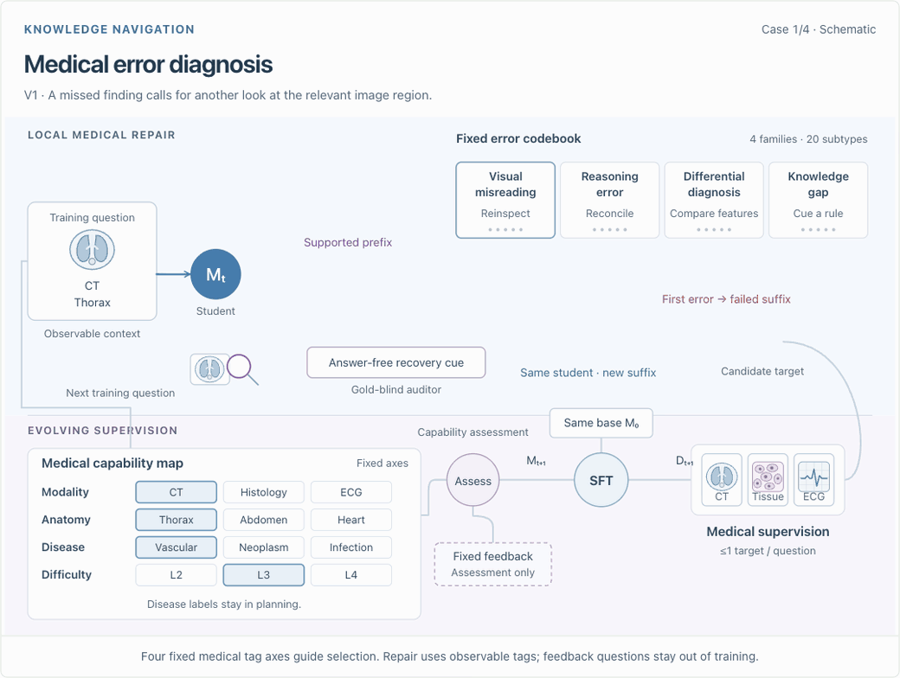

<div align="center">

<p> &nbsp;&nbsp;  &nbsp;&nbsp;  &nbsp;&nbsp; </p>

<h1> MedEvo: Medical Reasoning Evolution<br>through Knowledge Navigation</h1>

[](docs/assets/medevo.pdf)
[](https://pork-pay.github.io/MedEvo/)
[](https://github.com/pork-pay/MedEvo/stargazers)
[](#results)
[](#release-plan)

</div>

<p align="center">
  <a href="https://pork-pay.github.io/MedEvo/#method"></a>
</p>

<p align="center">
  <strong>Repair success is not learning value.</strong><br>
  Independent feedback guides what the student learns next.<br>
  <a href="https://pork-pay.github.io/MedEvo/#method">Explore the interactive walkthrough →</a>
</p>

## Results

**Accuracy (%) on seven medical multimodal benchmarks.**
Each cell shows **Base → MedEvo**: three rounds for 9B/35B and two rounds for 397B.

| Benchmark | Qwen3.5-9B | Qwen3.5-35B | Qwen3.5-397B |
|:--|:--:|:--:|:--:|
| PMC-VQA | 59.20 → 62.68 | 62.40 → 64.63 | 63.47 → 65.72 |
| VQA-RAD | 68.10 → 70.40 | 70.50 → 75.83 | 74.72 → 77.15 |
| SLAKE | 76.80 → 78.23 | 70.10 → 80.30 | 77.38 → 79.10 |
| PathVQA | 48.80 → 53.34 | 49.15 → 56.01 | 52.49 → 57.90 |
| OmniMedVQA | 82.20 → 85.41 | 83.20 → 83.97 | 85.10 → 85.05 |
| MedXpertQA-MM | 47.40 → 54.50 | 60.00 → 66.50 | 67.65 → 75.00 |
| MMMU-Med | 76.50 → 79.28 | 80.00 → 84.02 | 82.03 → 84.75 |
| **Mean (7 benchmarks)** | **65.57 → 69.12** | **67.91 → 73.04** | **71.83 → 74.95** |

The mean gives each benchmark equal weight. MedXpertQA-MM is the multimodal track of MedXpertQA; MMMU-Med is the medical subset of MMMU.

[Full results and comparisons →](https://pork-pay.github.io/MedEvo/#comparison)

## Release plan

| Item | Status |
|:--|:--|
| Paper (PDF) | ✅ [Available](docs/assets/medevo.pdf) |
| Project page & interactive demo | ✅ [Available](https://pork-pay.github.io/MedEvo/) |
| arXiv posting | 🔜 In progress |
| Discovered programs | ⏳ Being prepared |
| Full codebase | ⏳ Being prepared |
| Reproduction scripts | ⏳ Being prepared |

Related project: [ECG-RSI](https://pork-pay.github.io/ECG-RSI/)

<details>
<summary>Citation</summary>

```bibtex
@misc{wang2026medevo,
  title  = {MedEvo: Medical Reasoning Evolution through Knowledge Navigation},
  author = {Wang, Xiaoliang and Chen, Zhuo and Zheng, Chuanyang and
            Wang, Quanbin and Lao, Jiangwei and Liu, Yingao and Liu, Jiajia and
            Cao, Jinming and Lin, Honglin and Lu, Zhihong and Jin, Hao and
            Wang, Jian and Wu, Lijun},
  year   = {2026},
  url    = {https://pork-pay.github.io/MedEvo/}
}
```

</details>
